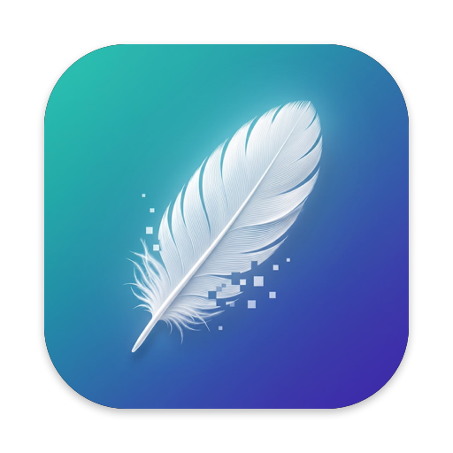
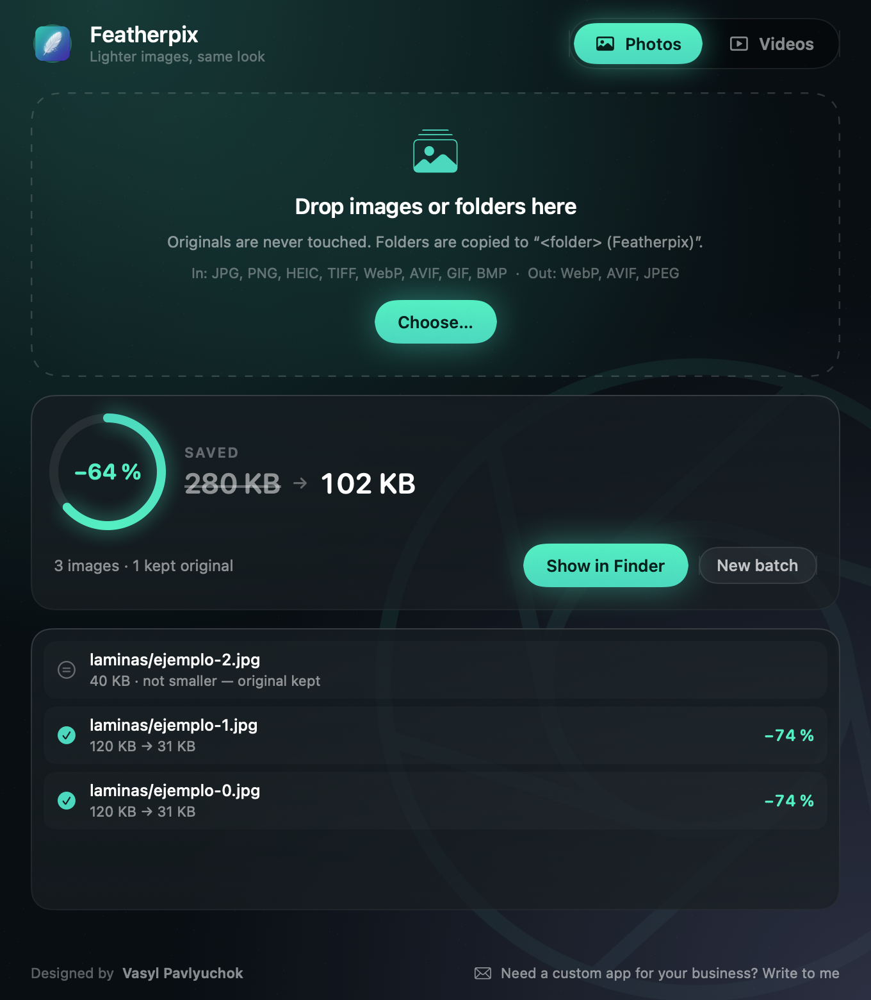

[🇪🇸 Español](README.md) | 🇬🇧 **English**



# Featherpix

[](../../releases/latest)
[](LICENSE)
[](../../releases/latest)

**Make your images much lighter, without anyone noticing.** Drop an image or a whole folder and Featherpix converts it to **WebP, AVIF or JPEG** at the quality and width you choose. It's free and open source, works offline, and sends nothing anywhere.

Designed by **Vasyl Pavlyuchok** & **Claude** · v1.0.0

<p align="center"></p>

---

## Why does it exist?

I had 325 design reference images (30 MB) to upload to Claude, and the browser only accepts about 10 MB. Online converters make you upload your images to someone else's server, and command-line tools make you remember flags. I wanted **drag and drop** that uses the same encoders I use to publish on my website (`cwebp`, Google's official one) and that tells me plainly how much it saved.

Featherpix bundles the reference encoders, built from source: **libwebp** for WebP, **libavif** with AOMedia's AV1 encoder for AVIF, and Mozilla's **mozjpeg** for JPEG. Nothing else to install.

**Alternatives:** if you want everything you copy or save to certain folders optimized automatically, [Clop](https://github.com/FuzzyIdeas/Clop) does that very well. Featherpix is simpler: drop, pick a format, done.

## Measured results

Real batch: 325 design boards, already-compressed JPEGs (30.98 MB). Full details in [docs/benchmark.md](docs/benchmark.md).

| Setting | Result | Saved | Visual similarity (SSIM) |
|---|---:|---:|---:|
| **Smallest** (AVIF 40 · 1200 px) | **8.85 MB** | **−71 %** | 0.975 |
| AVIF 45 | 12.10 MB | −61 % | 0.984 |
| **Web** (WebP 75 · 1920 px) | 18.70 MB | −40 % | 0.985 |
| **Compatible** (JPEG 75 · 1920 px) | 27.40 MB | −12 % | 0.996 |

Camera photos and PNG screenshots usually shrink a lot more; this batch was already heavily compressed.

---

## Downloads

| System | File |
|---|---|
| **macOS 13 or later** (Intel and Apple Silicon) | [`Featherpix-macOS.pkg`](../../releases/latest/download/Featherpix-macOS.pkg): double-click installer |
| | [`Featherpix-macOS.zip`](../../releases/latest/download/Featherpix-macOS.zip): the app on its own, drag it to Applications |

Each release ships SHA-256 checksums and a [GitHub build attestation](https://docs.github.com/actions/security-for-github-actions/using-artifact-attestations) proving the files were built by GitHub Actions from this source:
`gh attestation verify Featherpix-macOS.pkg -R vasyl-pavlyuchok/featherpix`

### ⚠️ macOS warning on first launch (expected)

Featherpix is free and isn't signed with a paid Apple certificate (about $99/year), so the first time macOS will say it **can't verify the developer**. The certificate only removes that warning; it doesn't change what the app does.

- **macOS 13 and 14:** right-click the `.pkg` (or the app) → **Open** → **Open**.
- **macOS 15 or later:** open the file once, go to **System Settings → Privacy & Security**, scroll to the Featherpix message, click **Open Anyway** and confirm with your password.

You only do this once. Featherpix **asks for no permissions**: no Accessibility, Screen Recording or network access.

---

## How it works

1. Open Featherpix and pick a **quick setting** (Web, Smallest or Compatible), or set format, quality and width yourself.
2. **Drop** images or folders on the window or on the Dock icon, or use **Choose…**.
3. When it finishes you see the size before and after. **Show in Finder** takes you to the result.

**Where results go:**
- A single image → next to the original, with the new extension (`photo.jpg` → `photo.webp`).
- A folder → a full copy next to it, `My folder (Featherpix)`, with the same subfolders.
- Or any folder you pick with **Save to folder…**.

**Originals are never modified or overwritten.** If two files would get the same name (`a.jpg` and `a.png` → `a.webp`), the second becomes `a (2).webp`.

## Features

- **WebP, AVIF and JPEG** using the reference encoders (libwebp 1.6, libavif 1.4 + libaom, mozjpeg 4.1).
- **Quality** 30–95, with each format's recommended value one click away.
- Optional **max width**: shrinks anything wider, never enlarges smaller images.
- **Keep original if not smaller:** if the result would be the same size or bigger, the original is kept (copied, for folders, so the copy is complete).
- **Whole folders** with subfolders, processed in parallel.
- Honours phone-photo **orientation** and converts colour to **sRGB**, so P3 and Adobe RGB images look right on the web.
- Transparency kept in WebP and AVIF; JPEG gets a white background and a warning.
- Strips metadata (EXIF, GPS), which costs bytes and can leak private data.
- End-of-run report: done, unchanged, and failed with the reason. Nothing fails silently.
- **English and Spanish** interface, following the system language.
- Command-line tool included (see below).

Accepted inputs: JPEG, PNG, HEIC/HEIF, TIFF, WebP, AVIF, GIF (first frame) and BMP.

### Command line

The app ships `featherpix-cli`:

```bash
ln -s /Applications/Featherpix.app/Contents/Resources/bin/featherpix-cli /usr/local/bin/featherpix
```

```bash
featherpix --preset smallest ~/Desktop/screenshots
```

```bash
featherpix -f webp -q 80 -w 1600 -o ~/Desktop/web photo1.jpg photo2.png
```

`featherpix --help` lists every option. The exit code is 1 if any image failed.

---

## Build from source

You need the Xcode Command Line Tools (`xcode-select --install`), CMake and NASM (`brew install cmake nasm`). Full Xcode is not required.

```bash
scripts/build-encoders.sh
```

```bash
ARCHS=$(uname -m) scripts/build-app.sh
```

```bash
tests/smoke.sh build/Featherpix.app
```

The first script downloads and builds the encoders at pinned commits (about 10 minutes). The second produces `build/Featherpix.app`, the `.zip` and the `.pkg`. The universal build (Intel + Apple Silicon) is made by GitHub Actions on every release, with one runner per architecture.

**Version:** lives only in the [`VERSION`](VERSION) file. CI refuses to publish if it doesn't match the tag.

## Uninstall

Drag **Featherpix** from Applications to the Trash. If you created the command-line link, remove `/usr/local/bin/featherpix` too. The app leaves nothing else behind apart from its preferences (`~/Library/Preferences/com.vasylpavlyuchok.featherpix.plist`).

## Privacy and security

- No internet access: no telemetry, no auto-update.
- Encoders are run with an argument list, never through a shell, so an odd filename can't execute anything (there's a test for it).
- Images over 200 megapixels are rejected before decoding.
- Symbolic links that point outside the dropped folder are not followed.
- Encoders are built from source at pinned commits; no third-party binaries.

## Changelog

### v2.0.0 — 13-nov-2026
- **Videos** tab: MP4 (H.264 or HEVC) for three uses (web, silent hero loop with poster and `<video>` snippet, best quality). Input MP4, MOV, M4V. Uses macOS VideoToolbox: no extra weight, no GPL code. WebM arrives in 2.1.
- New interface: each tab has its own mood (mint for photos, ember for videos) and an animated savings figure.
- Drops are routed to the right tab automatically.

### v1.1.0 — 13-nov-2026
- Visible input/output formats, credits and contact, `featherpix-cli --formats` / `--about`.

**v1.0.0 (12 Nov 2026):** first release. WebP, AVIF and JPEG, quality and max width, single images and folders, quick settings, keep-original-if-not-smaller, CLI, universal app with `.pkg` installer. Full changelog in the [Spanish README](README.md#changelog).

## License

[MIT](LICENSE) © 2026 Vasyl Pavlyuchok & Claude. The bundled encoders have their own free licenses (BSD, IJG, zlib): see [THIRD_PARTY_NOTICES.md](THIRD_PARTY_NOTICES.md). Full texts ship inside the app.
