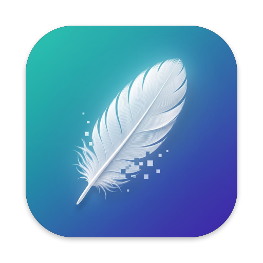
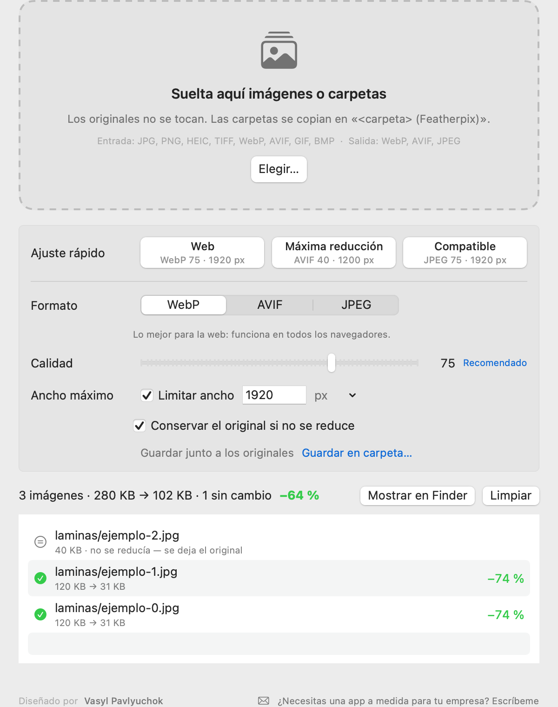
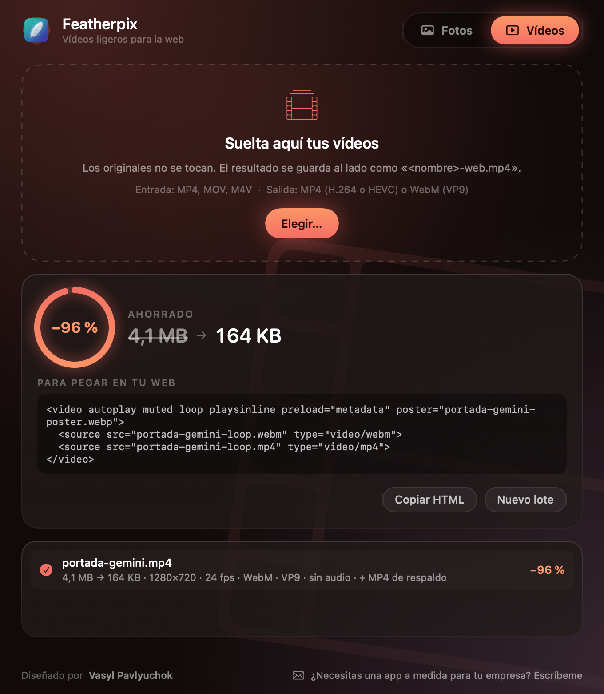

🇪🇸 **Español** | [🇬🇧 English](README.en.md)



# Featherpix

[](../../releases/latest)
[](LICENSE)
[](../../releases/latest)

**Aligera tus imágenes y tus vídeos sin que se note.** Suelta una imagen o una carpeta entera y Featherpix la convierte a **WebP, AVIF o JPEG**; suelta un vídeo y lo deja en un **MP4 o WebM** ligero para la web (H.264, HEVC o VP9), con portada en bucle lista para pegar. Es gratis y de código abierto, funciona sin conexión y no envía nada a ningún sitio.

Diseñado por **Vasyl Pavlyuchok** & **Claude** · v2.1.1

<p align="center"> </p>
<p align="center"><sub>Pestaña <b>Fotos</b> (WebP, AVIF, JPEG) y pestaña <b>Vídeos</b> (MP4 o WebM)</sub></p>

---

## ¿Por qué existe?

Tenía 325 imágenes de referencia de diseño (30 MB) que quería subir a Claude, y el navegador solo acepta unos 10 MB. Los conversores online te obligan a subir tus imágenes a un servidor ajeno, y las herramientas de línea de comandos piden recordar parámetros. Quería algo de **arrastrar y soltar** que use los mismos codificadores que uso para publicar en mi web (`cwebp`, el oficial de Google) y que diga claramente cuánto ha ahorrado.

Featherpix lleva dentro los codificadores de referencia, compilados desde su código fuente: **libwebp** para WebP, **libavif** con el codificador AV1 de AOMedia para AVIF y **mozjpeg** de Mozilla para JPEG. No hace falta instalar nada más.

**Alternativas:** si lo que buscas es que se optimice solo todo lo que copias o guardas en ciertas carpetas, [Clop](https://github.com/FuzzyIdeas/Clop) hace eso muy bien. Featherpix es más sencillo: arrastras, eliges el formato y listo.

## Resultados medidos

Lote real: 325 láminas de diseño ya comprimidas en JPEG (30,98 MB). Detalle completo en [docs/benchmark.md](docs/benchmark.md).

| Ajuste | Resultado | Ahorro | Similitud visual (SSIM) |
|---|---:|---:|---:|
| **Máxima reducción** (AVIF 40 · 1200 px) | **8,85 MB** | **−71 %** | 0,975 |
| AVIF 45 | 12,10 MB | −61 % | 0,984 |
| **Web** (WebP 75 · 1920 px) | 18,70 MB | −40 % | 0,985 |
| **Compatible** (JPEG 75 · 1920 px) | 27,40 MB | −12 % | 0,996 |

Con fotos de cámara o capturas PNG el ahorro suele ser bastante mayor; este lote ya venía muy comprimido.

---

## Descargas

| Sistema | Archivo |
|---|---|
| **macOS 13 o superior** (Intel y Apple Silicon) | [`Featherpix-macOS.pkg`](../../releases/latest/download/Featherpix-macOS.pkg): instalador de doble clic |
| | [`Featherpix-macOS.zip`](../../releases/latest/download/Featherpix-macOS.zip): la app suelta, para arrastrarla a Aplicaciones |

Cada release publica el SHA-256 de los archivos y una [atestación de compilación de GitHub](https://docs.github.com/actions/security-for-github-actions/using-artifact-attestations) que demuestra que se compilaron en GitHub Actions a partir de este código:
`gh attestation verify Featherpix-macOS.pkg -R vasyl-pavlyuchok/featherpix`

### ⚠️ Aviso de macOS la primera vez (es normal)

Featherpix es gratuito y no está firmado con un certificado de Apple de pago (unos 99 €/año). Por eso, la primera vez macOS dirá que **no puede verificar al desarrollador**. El certificado solo quita ese aviso; no cambia lo que hace la app.

- **macOS 13 y 14:** clic derecho sobre el `.pkg` (o sobre la app) → **Abrir** → **Abrir**.
- **macOS 15 o superior:** abre el archivo una vez, ve a **Ajustes del Sistema → Privacidad y seguridad**, baja hasta el aviso de Featherpix, pulsa **Abrir igualmente** y confirma con tu contraseña.

Solo hay que hacerlo una vez. Featherpix **no pide permisos** de accesibilidad, de grabación de pantalla ni de red.

---

## ¿Cómo funciona?

1. Abre Featherpix y elige un **ajuste rápido** (Web, Máxima reducción o Compatible), o ajusta formato, calidad y ancho a mano.
2. **Suelta** imágenes o carpetas en la ventana, o en el icono del Dock, o usa **Elegir…**.
3. Cuando termina verás cuánto pesaban antes y después. **Mostrar en Finder** te lleva al resultado.

**Dónde se guarda:**
- Una imagen suelta → al lado del original, con la nueva extensión (`foto.jpg` → `foto.webp`).
- Una carpeta → una copia completa al lado, `Mi carpeta (Featherpix)`, con la misma estructura de subcarpetas.
- O en la carpeta que elijas con **Guardar en carpeta…**.

**Los originales nunca se modifican ni se sobrescriben.** Si dos archivos acabarían con el mismo nombre (`a.jpg` y `a.png` → `a.webp`), el segundo se guarda como `a (2).webp`.

## Funcionalidades

- **WebP, AVIF y JPEG** con los codificadores de referencia (libwebp 1.6, libavif 1.4 + libaom, mozjpeg 4.1).
- **Calidad** de 30 a 95 con el valor recomendado de cada formato a un clic.
- **Ancho máximo** opcional: reduce lo que sea más ancho y nunca amplía lo más pequeño.
- **Conservar el original si no se reduce:** si el resultado pesaría lo mismo o más, se deja el original (en carpetas se copia, para que la copia quede completa).
- **Carpetas enteras** con subcarpetas, procesadas en paralelo.
- Respeta la **orientación** de las fotos del móvil y convierte el color a **sRGB** (los perfiles P3 o Adobe RGB se ven bien en la web).
- Transparencia conservada en WebP y AVIF; en JPEG se pone fondo blanco y te avisa.
- Elimina los metadatos (EXIF, GPS), que también pesan y pueden revelar datos privados.
- Informe al final: correctas, sin cambio y fallidas con el motivo. Nada falla en silencio.
- Interfaz en **español e inglés** según el idioma del sistema.
- Herramienta de línea de comandos incluida (ver abajo).

Entradas admitidas: JPEG, PNG, HEIC/HEIF, TIFF, WebP, AVIF, GIF (primer fotograma) y BMP.

### Vídeos (desde la v2.0)

- **Entrada:** MP4, MOV y M4V. **Salida:** MP4 con H.264 (se ve en todas partes), HEVC (un 40 % más ligero en equipos recientes) o **WebM con VP9 y audio Opus** (desde la v2.1, lo más ligero para la web; por defecto añade una copia MP4 para navegadores antiguos y el código `<video>` lleva las dos).
- **Para qué es:** *Web* (≤1920 px, con audio), *Portada en bucle* (≤1280 px, sin audio, con imagen fija `.webp` y el código `<video>` listo para copiar) y *Máxima calidad* (tamaño original).
- MP4 y HEVC salen del codificador de vídeo de macOS (VideoToolbox). WebM sale de un **ffmpeg reducido con licencia LGPL** (sin piezas GPL, sin red: solo lee y escribe ficheros) que va dentro de la app como programa aparte.
- Respeta la rotación de los vídeos del móvil, coloca el índice al principio del fichero para que empiece a reproducirse antes de descargarse entero, y nunca toca el original.
- `featherpix-cli video -p loop portada.mp4` hace lo mismo desde la terminal.

### Línea de comandos

La app incluye `featherpix-cli`:

```bash
ln -s /Applications/Featherpix.app/Contents/Resources/bin/featherpix-cli /usr/local/bin/featherpix
```

```bash
featherpix --preset smallest ~/Desktop/capturas
```

```bash
featherpix -f webp -q 80 -w 1600 -o ~/Desktop/web foto1.jpg foto2.png
```

`featherpix --help` muestra todas las opciones. Devuelve código 1 si alguna imagen falla.

---

## Compilar desde el código

Necesitas las Command Line Tools de Xcode (`xcode-select --install`), CMake y NASM (`brew install cmake nasm`). No hace falta Xcode completo.

```bash
scripts/build-encoders.sh
```

```bash
ARCHS=$(uname -m) scripts/build-app.sh
```

```bash
tests/smoke.sh build/Featherpix.app
```

El primer script descarga y compila los codificadores en las versiones fijadas por commit (unos 10 minutos). El segundo genera `build/Featherpix.app`, el `.zip` y el `.pkg`. La versión universal (Intel + Apple Silicon) la compila GitHub Actions en cada release, con un runner por arquitectura.

**Versión:** vive solo en el archivo [`VERSION`](VERSION). La CI se niega a publicar si no coincide con el tag.

## Desinstalación

Arrastra **Featherpix** de Aplicaciones a la Papelera. Si creaste el enlace de la línea de comandos, bórralo también: `/usr/local/bin/featherpix`. La app no deja nada más en tu Mac, salvo sus preferencias (`~/Library/Preferences/com.vasylpavlyuchok.featherpix.plist`).

## Privacidad y seguridad

- Sin conexión a internet: ni telemetría ni actualizaciones automáticas.
- Los codificadores se ejecutan con sus argumentos en lista, nunca a través de una shell, así que un nombre de archivo raro no puede ejecutar nada (hay una prueba para ello).
- Rechaza imágenes de más de 200 megapíxeles antes de descomprimirlas.
- No sigue enlaces simbólicos que salgan de la carpeta que sueltas.
- Los codificadores se compilan desde su código fuente en commits fijados, sin binarios de terceros.

## Changelog

### v2.1.1 — 13-nov-2026
- La ayuda de `featherpix-cli` indica que los vídeos salen en MP4 o WebM.

### v2.1.0 — 13-nov-2026
- **WebM** (VP9 + audio Opus) en la pestaña Vídeos y en `featherpix-cli video -c vp9`. Por defecto añade una copia MP4 de respaldo y el código `<video>` incluye las dos fuentes (WebM primero). `--no-fallback` la omite.
- Incluye un ffmpeg LGPL compilado desde su código fuente en un commit fijado, con solo lo necesario (sin red, sin GPL). Su licencia y su origen van dentro de la app.

### v2.0.0 — 13-nov-2026
- Pestaña **Vídeos**: MP4 (H.264 o HEVC) con tres usos (web, portada en bucle con póster y código HTML, máxima calidad).
- Interfaz nueva: cada pestaña tiene su propio ambiente (menta para fotos, brasa para vídeos) y una cifra de ahorro animada.
- Lo que sueltes va solo a su pestaña: imágenes a Fotos, vídeos a Vídeos.

### v1.1.0 — 13-nov-2026
- Formatos de entrada y salida visibles, firma y contacto, `featherpix-cli --formats` / `--about`.

### v1.0.0 — 12-nov-2026
- Primera versión: WebP, AVIF y JPEG; calidad y ancho máximo; imágenes sueltas y carpetas; ajustes rápidos Web, Máxima reducción y Compatible; conservar el original si no se reduce; herramienta de línea de comandos; app universal Intel + Apple Silicon con instalador `.pkg`.
- Valores por defecto medidos sobre un lote real de 325 imágenes ([docs/benchmark.md](docs/benchmark.md)).

## Licencia

[MIT](LICENSE) © 2026 Vasyl Pavlyuchok & Claude. Los codificadores incluidos tienen sus propias licencias libres (BSD, IJG, zlib y LGPL 2.1 para ffmpeg): ver [THIRD_PARTY_NOTICES.md](THIRD_PARTY_NOTICES.md). Los textos completos van dentro de la app. ffmpeg (LGPL 2.1+, https://ffmpeg.org) va como programa aparte; su código fuente correspondiente se adjunta en cada release de GitHub y puedes sustituirlo por tu propia compilación.
